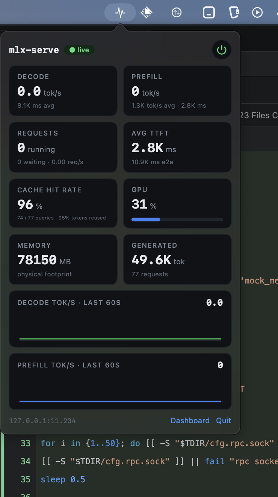
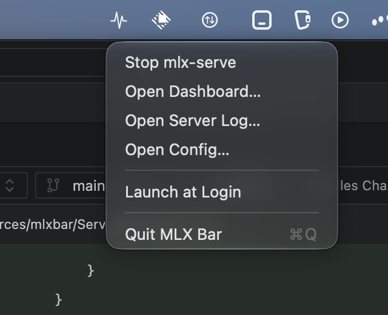

# mlx-serve-bar

A tiny macOS menu-bar app to start, stop, and monitor [mlx-serve](https://github.com/ddalcu/mlx-serve) — the native MLX inference server for Apple Silicon ([MLX](https://github.com/ml-explore/mlx) is the underlying framework) — [sushi](https://github.com/ddalcu/sushi), its MLX pack server, or [splash](https://herdr.dev)'s local server, without leaving the menu bar — plus a live panel of the [Pi](https://pi.dev) agent sessions running against it.

No dock icon, no notifications, no window chrome — one template icon in the menu bar:

- **Click the icon** → popover with live stats, the Pi sessions on this machine, power button, Dashboard/Quit links
- **Right-click the icon** → Start/Stop, Open Dashboard, Open Server Log, Open Config, Launch at Login, Quit
- **Nothing else.** No hover zones, no proximity magic — the panel only opens when you actually press the icon.





## What it shows

Every metric, label, formula, and color is a faithful port of the [mlx-serve](https://github.com/ddalcu/mlx-serve) dashboard's own metrics panel (the embedded JS in its index page), so the menu-bar popover and the browser dashboard always agree:

| Tile | Source (per dashboard tick) |
|---|---|
| Decode tok/s | `generation_tokens_live` delta over a trailing 4 s window, while `requests_running > 0`; 0 when idle — live speed, never counter averages |
| Prefill tok/s | `prefill_tokens_live` delta over a trailing 30 s window while prefilling; 0 otherwise |
| Prefill sub | `prefill_tokens_total ÷ prefill_time_seconds.sum` (forwarded tokens, never billed tokens), or `prefilling · N tok` while a prefill chunk lands |
| Requests | `requests_running`, sub `N waiting · r.rr req/s` over a 60 s window |
| Avg TTFT | `time_to_first_token_seconds.sum ÷ count`, sub `e2e_request_latency_seconds` average |
| Cache hit rate | `prefix_cache_hits_total ÷ prefix_cache_queries_total`, sub `h / q queries · r% tokens reused` (prefix-cache tokens ÷ prompt tokens) |
| GPU | `gpu_utilization_pct` with a bar: `#3b82f6`, `#f59e0b` ≥ 70, `#ef4444` ≥ 90 |
| Memory | `memory_mb` physical footprint |
| Generated | live generation gauge (moves mid-request), sub `N requests` |
| Sparklines | last 60 ticks (1 s poll), auto-scaled, decode `#22c55e`, prefill `#3b82f6` |

All rates are re-derived from the current feed on every tick — nothing is carried between ticks, no smoothing, no EMA. Numbers are formatted with the dashboard's own `fmt()` (≥1 M → `x.xM`, ≥1 K → `x.xK`, else fixed decimals).

The app polls `/metrics.json` every 1 s (like the dashboard); if metrics fail but `/health` answers, it freezes the last frame instead of showing zeros. A server restart (detected by counter regression) clears the rate windows, exactly like reloading the dashboard page.

Both backends expose the same `/health`, `/metrics.json` shape and metric names, so one metrics engine covers them. Sushi's metrics endpoint is opt-in (`--metrics` / `POST /metrics/enable`); the bar enables it automatically when it sees the plain-text "metrics not enabled" answer, so an externally started sushi still fills every tile.

### splash

[splash](https://herdr.dev) serves the same `/health` and OpenAI-compatible API, but its metrics are Prometheus text on `/metrics` with their own `splash_*` vocabulary and no `/metrics.json`. `MetricsEngine` maps it onto the same tiles:

| Tile | splash source |
|---|---|
| Decode tok/s | Δ `splash_decode_output_tokens_total` over the same 4 s window, gated on a request actually running |
| Prefill tok/s | Δ `splash_prefill_input_tokens_total` (forwarded tokens) over 30 s while `splash_scheduler_prefilling` |
| Prefill sub | `splash_prefill_input_tokens_total ÷ splash_prefill_wall_milliseconds_total` — reproduces splash's own `splash_prefill_tokens_per_second` |
| Requests | `splash_state_active_lanes` ∪ `splash_scheduler_decoding/prefilling` · sub `frontend_waiting + scheduler_queued + admission_waiting_concurrency` |
| Avg TTFT / e2e | `splash_http_ttft_seconds.sum/.count`, `splash_http_request_seconds.sum/.count` |
| Cache hit rate | `splash_cache_hits_total ÷ (hits + cold_misses)`; reused tokens = `splash_cache_reused_tokens_total ÷ (reused + forwarded)` |
| GPU | derived: Δ(`decode_wall` + `prefill_wall`) ms ÷ elapsed ms — splash publishes no utilization gauge |
| Memory | `splash_memory_current_bytes` (resident, includes the KV arena it holds in RAM) |
| Generated | lifetime output tokens · sub adds `splash_draft_acceptance_ratio` as *% draft accepted* (speculative decoding) |

Two honest gaps, both because splash has no such gauge: decode is the counter delta over the window rather than a mid-request live count, and GPU % is derived busy time (100 % while it streams, 0 % when idle) rather than a reported utilization. Everything else matches the numbers splash itself reports.

The feed format is sniffed from the response body, so swapping mlx-serve for splash on the same port keeps rendering; backend adoption then rewrites `config.json` and re-points the poller.

## Requirements

- macOS 14+ on Apple Silicon
- [mlx-serve](https://github.com/ddalcu/mlx-serve), [sushi](https://github.com/ddalcu/sushi) or [splash](https://herdr.dev) (or any server exposing the same `/health` + `/metrics.json` panel endpoints) running on the Mac
- Xcode command line tools (Swift 5.9+) to build

## Install

```sh
git clone https://github.com/2mawi2/mlx-serve-bar
cd mlx-serve-bar
./build.sh --install    # build + selftest + bundle + copy to ~/Applications + launch
```

Then right-click the waveform icon → **Launch at Login** if you want it permanent.

## Configuration

On first launch the app scans running processes for an `mlx-serve` or `sushi` server, adopts its arguments, and writes `~/Library/Application Support/MLXBar/config.json`:

```json
{
  "bin": "/Users/you/.local/bin/mlx-serve-start",
  "args": [],
  "host": "127.0.0.1",
  "port": 11234,
  "backend": "mlx-serve"
}
```

- `bin` + `args` are what the power button (or `ctl start`) launches; point `bin` at your start wrapper so safety checks (port guards, model verification) still run.
- `backend` is `mlx-serve`, `sushi` or `splash`. If omitted, the app infers it from the `bin` path and from the live server (process name, or `/v1/models`'s `owned_by`); an already-running server of another flavor is adopted and config.json is rewritten so the power button launches the right launcher.
- splash runs as two processes (`python3 -m server.server` plus its native engine, both carrying the engine binary in argv) and has no `splash-start` here, so its launcher lookup also accepts a `<backend>-*-start` wrapper (`splash-swap-start`).
- Sushi serves Prometheus metrics only on demand (`--metrics` or `POST /metrics/enable`). The bar enables them itself on startup, so a sushi started outside the app still fills every tile; the shipped `sushi-deepseek-start` wrapper also passes `--metrics` directly.
- Server stdout/stderr goes to `~/Library/Logs/MLXBar/server.log` (menu → Open Server Log).
- The app itself is `LSUIElement`: never in the Dock, never steals focus.

## Scripting (`ctl`)

The running app exposes a tiny unix-socket RPC (socket next to the config file):

```sh
mlx-bar ctl [--config <path>] status  # JSON: state, pid, live metrics
mlx-bar ctl agent                     # JSON: live Pi sessions (model, context, tokens)
mlx-bar ctl ping | start | stop | quit
mlx-bar ctl rect | panel | events      # diagnostics (icon rect, panel visible, UI event log)
mlx-bar ctl privacy                    # privacy settings + KV cache size (active backend)
mlx-bar ctl privacy-set <key> <0|1>    # telemetry|ephemeral|server_log|kv_cache
mlx-bar ctl cache-clear                # delete persisted KV cache entries (active backend)
```

`ctl` is what the bundled `tools/lifecycle_test.sh` drives.

## Pi sessions

The server tiles say what the GPU is doing, not who is asking. The top of the popover
lists the [Pi](https://pi.dev) sessions on this machine: project, model, phase
(`decoding` / `tool → request` / `requesting` / `idle`), how full the context window is,
output tokens, agent-side tok/s, cache reuse and cost.

It reads Pi's own transcripts (`~/.pi/agent/sessions/<cwd>/*_<id>.jsonl`, append-only), so
no Pi plugin or setting is involved, and every session shows up — including subagents and
other projects. Per tick the reader only consumes the bytes each file appended since the
last tick, and it caches the model → context-window lookup from `models.json` /
`models-store.json`.

What it reads and what it does not:

- Only structural fields: `cwd`, `session_info` name, `model_change`/message model ids,
  `usage` numbers, `durationMs`, `stopReason`, thinking level. Prompt, tool-output and
  reply **text is parsed past and never leaves the process** — a selftest asserts a marker
  string in the transcript never appears in `ctl agent` output.
- Sessions are listed for 5 minutes after their last write (the `phase` label is a
  heuristic off file freshness, not a live state), and no more than 16 files are read per tick.
- Ephemeral sessions (`--no-session`, or the `ephemeral` privacy switch below) write no
  transcript, so they are absent — that is the point of that switch.
- The transcript lives on disk anyway; the bar adds no new store and serves nothing beyond
  the local unix socket, exactly like the rest of `ctl`.

## Privacy

Four switches, one file: `~/.pi/agent/mlx-bar-privacy.conf` (valid shell — editable by hand).
Right-click the menu bar icon → **Privacy** to toggle them; the menu also shows the on-disk KV
cache size and offers *Reveal in Finder* / *Clear*.

| key | default | effect |
|---|---|---|
| `telemetry` | `0` | pi install/update telemetry (mirrored in `enableInstallTelemetry`) |
| `ephemeral` | `1` | `~/.local/bin/pi` adds `--no-session` unless you pass `-c/--continue/--session` or `PI_PERSIST=1` |
| `server_log` | `1` | `0` ⇒ the launcher adds `--log-level warn --log-file off` |
| `kv_cache` | `1` | `0` ⇒ the launcher drops `--prefix-cache-disk` (no prompt-derived state written) |

KV cache inspection follows the active backend: **Reveal in Finder** / **Clear KV Cache**
operate on `~/.mlx-serve/kv-cache` for mlx-serve and `~/.sushi/kv-cache` for sushi.
`ctl privacy` reports both the backend and that backend's cache size. splash keeps its
KV state in RAM, so the menu says so and reports no cache instead of inventing one.

Per-invocation env vars still win: `PI_TELEMETRY`, `PI_PERSIST`, `PI_DEFAULT_EPHEMERAL`,
`MLX_SERVE_PRIVATE`, `MLX_SERVE_LOG_LEVEL`, `MLX_SERVE_LOG_FILE`.

**Leave the KV cache on unless you care more about disk than speed.** It is the main lever behind
96 % prompt reuse — a cold re-prefill of a 100 K-token context costs 60–150 s. It lives outside
`~/Library/Caches`, so macOS never cleans it; the server evicts entries under its byte budget, but
the *real* footprint runs ~2.4× that budget because SSM checkpoints are not counted in it
(measured: 60 entries ≈ 39 GB with `--prefix-cache-disk 16GB`). Use **Clear KV Cache** when you
want the space back — it is rewritten on demand.

## Development

```sh
swift build
.build/release/mlxbar --selftest     # 95 checks: rate math, parsers, formatting, Pi sessions
./tools/lifecycle_test.sh            # full lifecycle against a mock server (never touches yours)
./build.sh                           # bundle dist/MLXBar.app
./build.sh --install                 # + copy to ~/Applications and relaunch
```

Layout:

```
Sources/mlxbar/
  main.swift            entry point: --selftest | ctl | GUI
  Backend.swift         which server it is: detection, launcher, metrics endpoint
  Config.swift          config file, process discovery, shell-out helpers
  Metrics.swift         the dashboard rate math ported 1:1 + JSON/Prometheus parsers + 1 s poller
  AgentStats.swift      incremental reader over ~/.pi/agent/sessions (Pi's own transcripts)
  Formats.swift         dashboard fmt()/rounding port
  ServerController.swift spawn/terminate/external-detect + ctl status JSON
  StatusController.swift status item, popover, menu, click handling
  DashboardView.swift   SwiftUI tiles/sparklines/Pi-session rows with the dashboard CSS palette
  LoginItem.swift, RPC.swift, SelfTest.swift
build.sh, tools/        bundling, mock server, lifecycle test, CGEvent click helper
```

## License

MIT — see [LICENSE](LICENSE).
